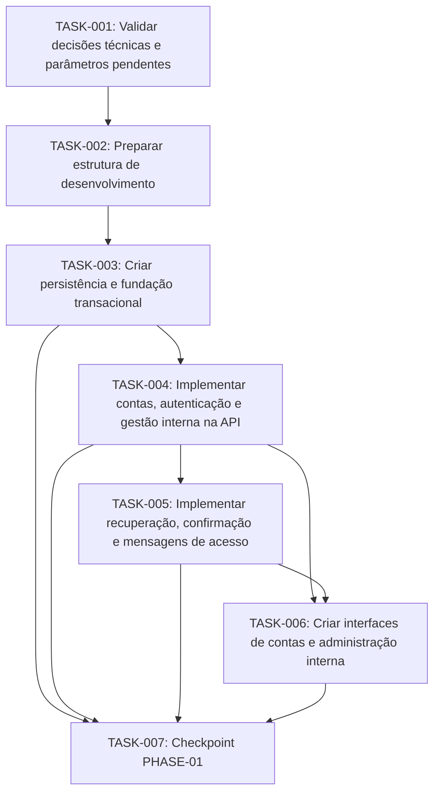
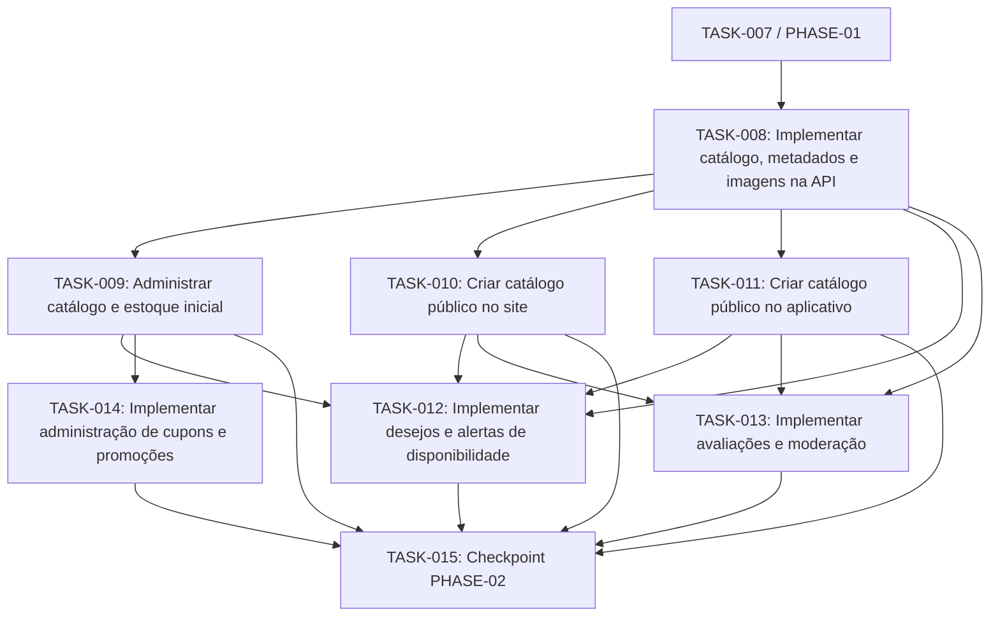
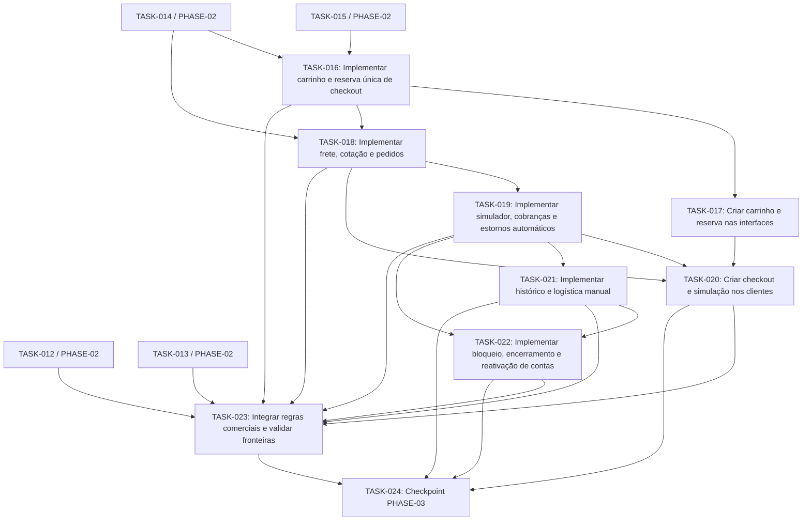
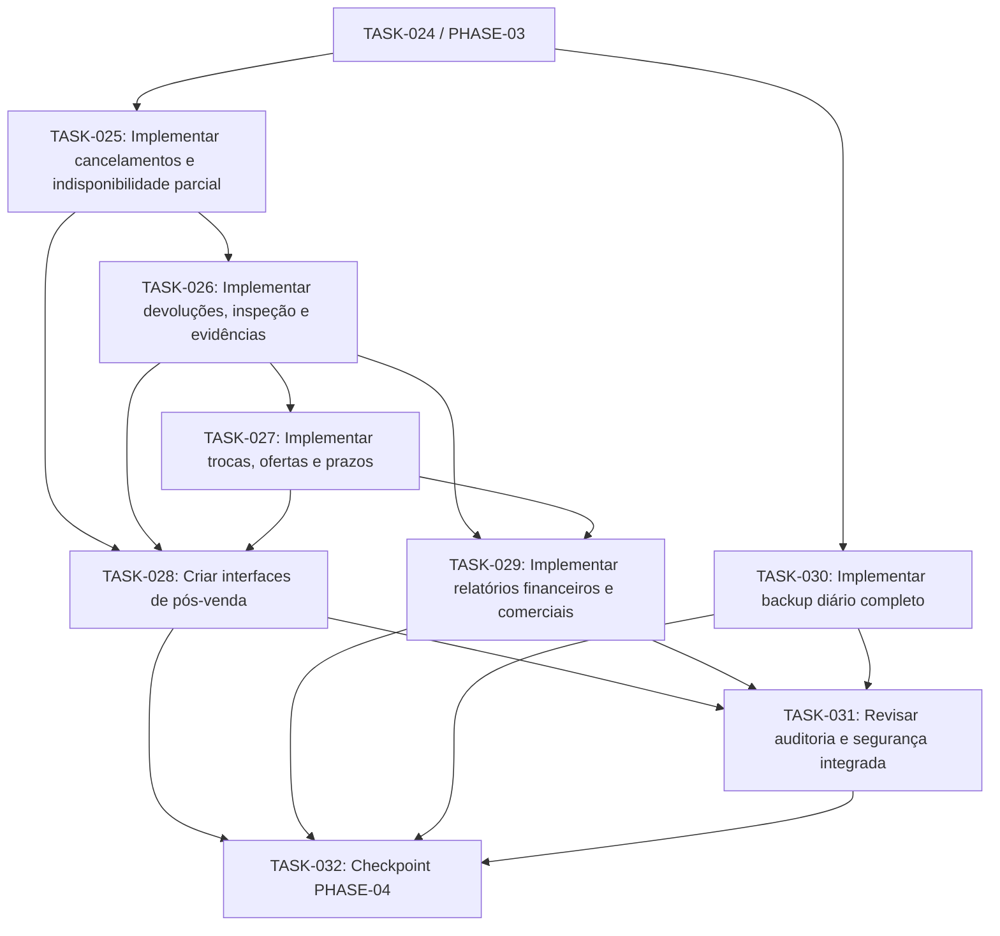
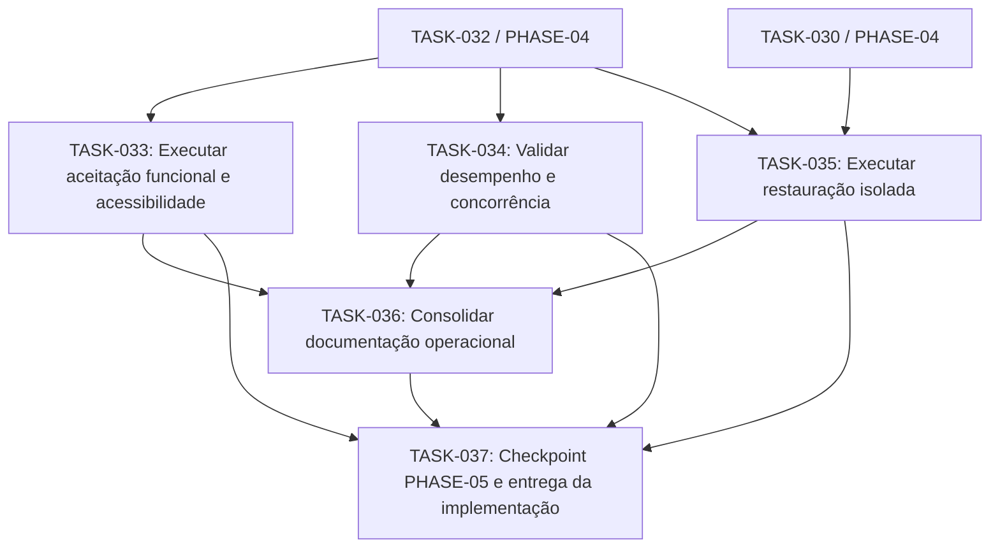

# Dependências de execução

Grafo dividido por fase para leitura. Cada aresta vai da dependência para a tarefa; a união das cinco vistas mantém todas as dependências do backlog. Nós de outra fase mostram o ID e a origem. Nenhuma tarefa está autorizada a iniciar na etapa documental atual.

## PHASE-01

## PHASE-02

## PHASE-03

## PHASE-04

## PHASE-05

Checkpoints: TASK-007, TASK-015, TASK-024, TASK-032 e TASK-037. TASK-019 entrega estornos automáticos antes de TASK-025, evitando ciclo. Pendências e ADRs são condições adicionais ao grafo.
