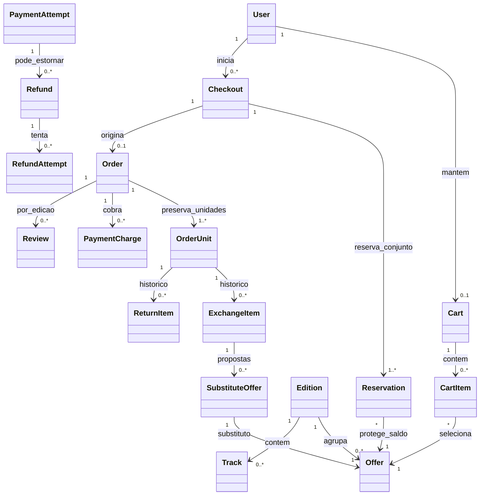

# Modelo conceitual

RN-004/007/009/025/034. Unidade comercial continua a mesma após trocar o exemplar físico. Carrinho não tem reserva; checkout e ofertas de substituto têm.

Checkout tem no máximo um ativo por USER. OrderUnit tem no máximo um atendimento ativo; cardinalidade histórica não implica simultaneidade. Tentativa de cartão pode existir sem Order, permitindo estorno tardio sem criar venda fictícia. Equipe usa contexto STAFF separado.
