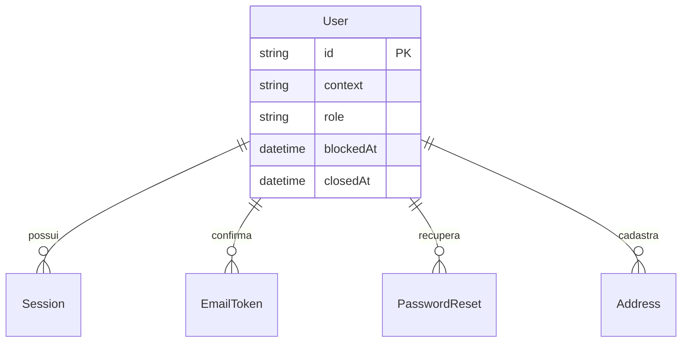
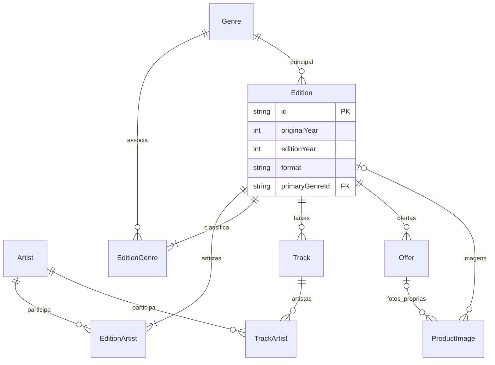
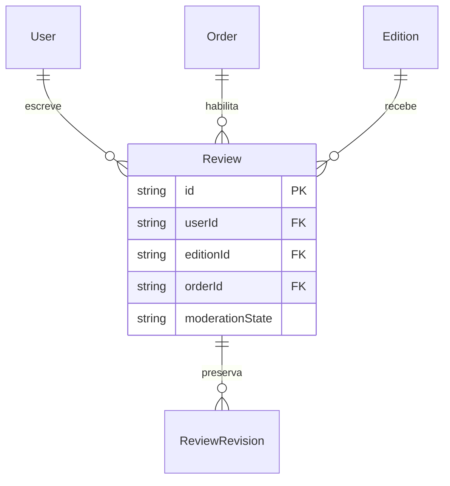
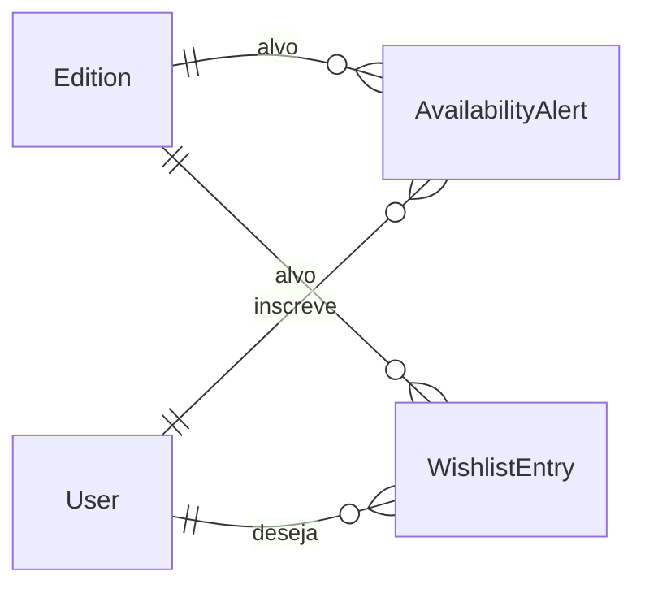

# ER — contas, catálogo e engajamento

Detalhes em [modelo de dados](../architecture/data-model.md); RN-001/025/036/045. Quatro vistas do mesmo modelo, com entidades repetidas para leitura. Campos opcionais e restrições completas estão na tabela de dados.

## Contas e credenciais

USER compra; ADMIN/OPERATOR são internos. Tokens não guardam segredo em claro. Contexto, papel e estado são verificados nas operações.

## Edições, artistas, faixas e imagens

ProductImage tem dono exclusivo edição OU oferta. Ano original e ano da edição são distintos; campos desconhecidos seguem a tabela de dados. Evidências de pós-venda não são fotos públicas.

## Avaliações

Review é única por cliente/edição/pedido.

## Desejos e alertas

Desejo não reserva nem ativa alerta; alerta NEW/USED/ANY encerra somente após entrega bem-sucedida.
