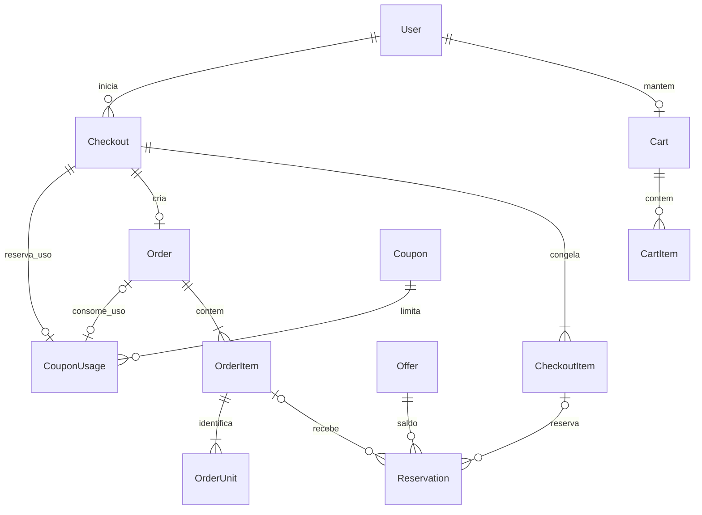
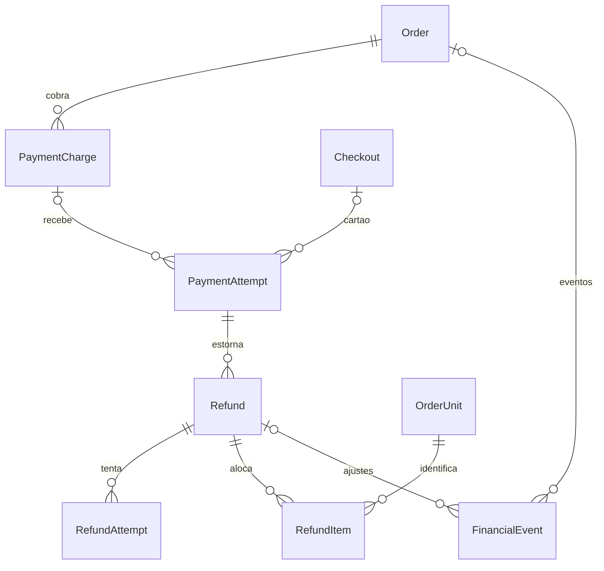
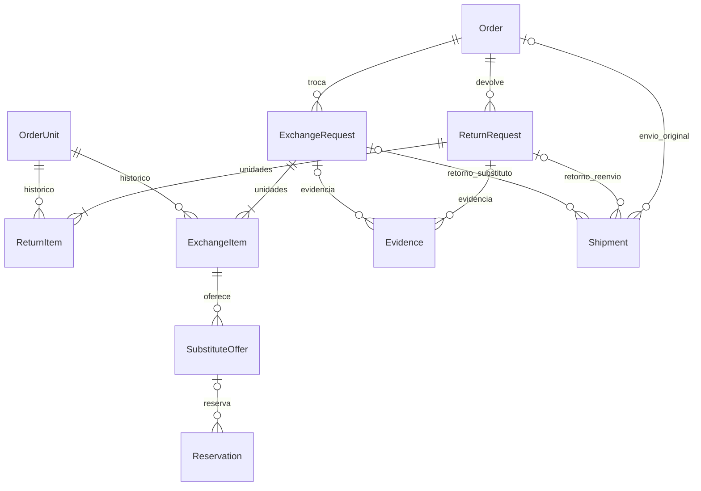

# ER — comércio e pós-venda

RN-007/011/017/022/034/039/041. [Modelo completo](../architecture/data-model.md). Três vistas do mesmo modelo; repetição de entidade não cria outra tabela. FKs opcionais e exclusividade de dono estão no detalhamento.

## Carrinho, checkout, reservas e pedido

CartItem não possui reserva. Checkout tem no máximo um ativo por cliente; transferência ao pedido é atômica. Uso de cupom reservado no checkout e consumido na criação do pedido.

## Cobranças, estornos e eventos financeiros

PaymentAttempt pode vir de checkout de cartão OU cobrança Pix/boleto. Cartão tardio pode ter Refund sem Order/RefundItem. Tentativa de estorno falha não se torna evento de reembolso concluído.

## Atendimentos, substitutos e remessas

Uma remessa ORIGINAL por pedido; retorno/substituto/rejeitado têm registros separados. Evidência pertence a um atendimento e é privada. Unidade comercial tem vários atendimentos históricos, nunca dois ativos ao mesmo tempo.
