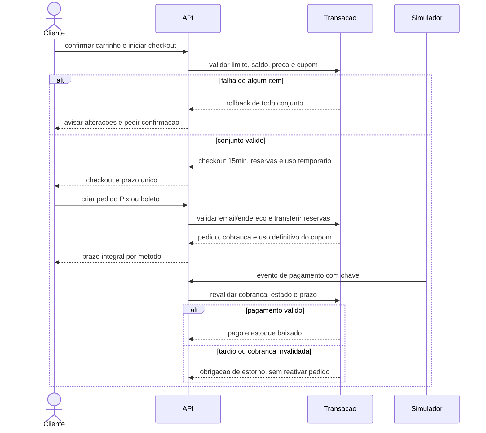
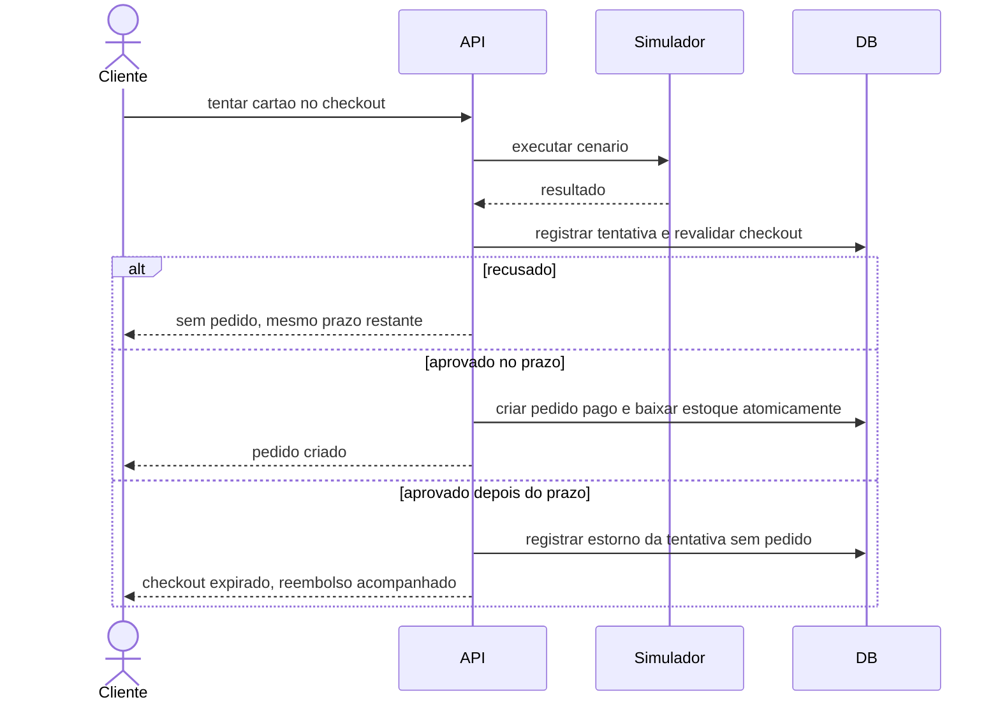
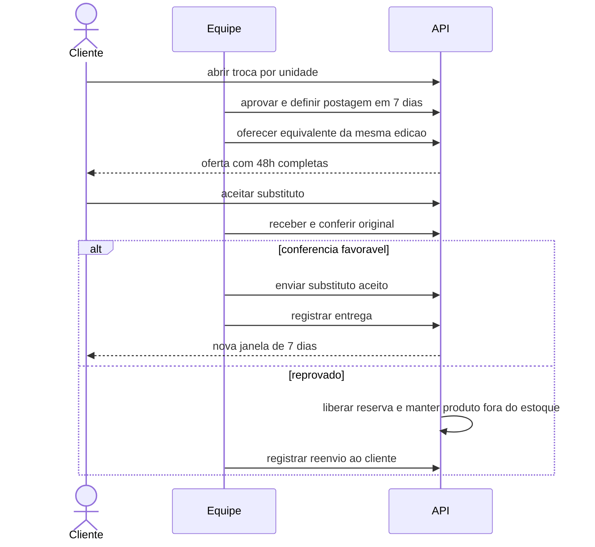
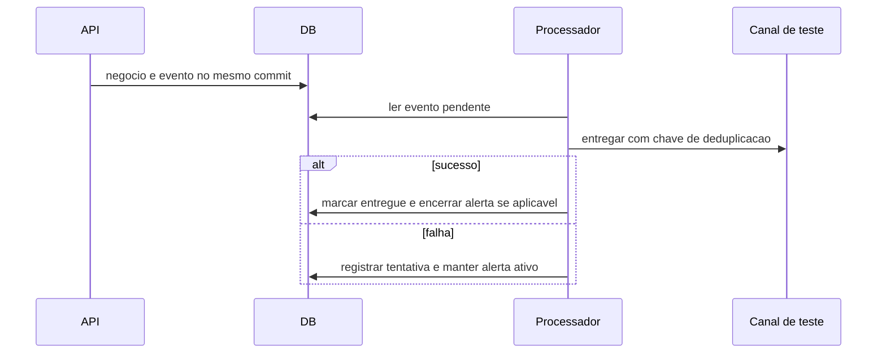

# Sequências principais

## Checkout e Pix/boleto — RN-006/007/011/017

## Cartão — RN-012/013

## Troca — RN-020/022/023/040

Oferta pode preceder retorno; envio não. Sem equivalente, espera formal começa após conferência; conversão em devolução não dispensa ADMIN para estorno.

## Notificação — RN-024/042

