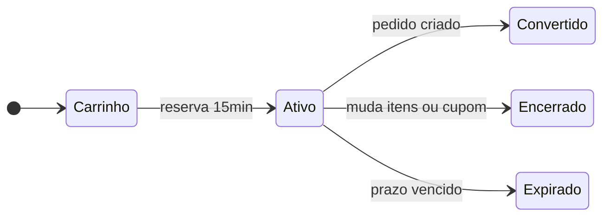
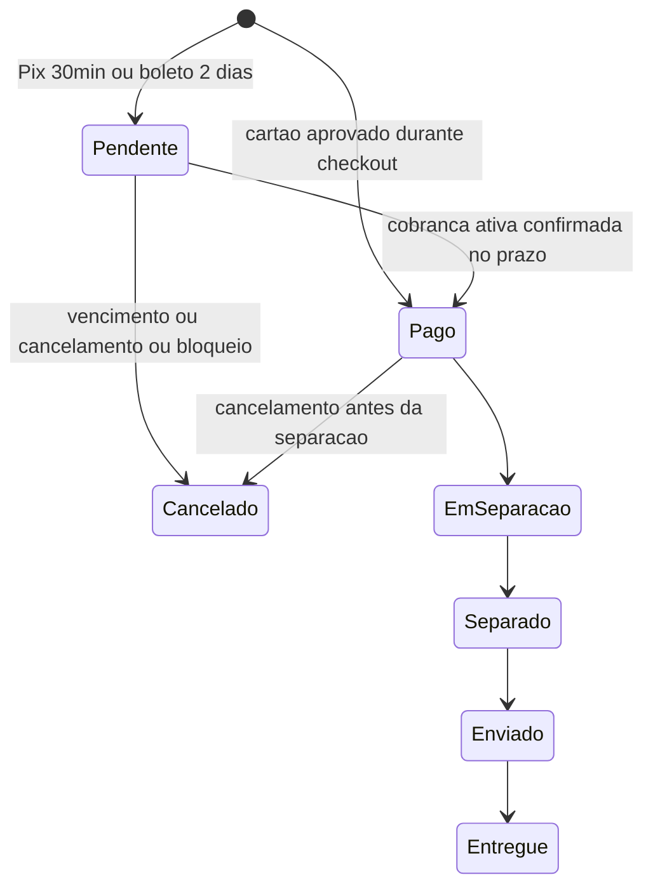
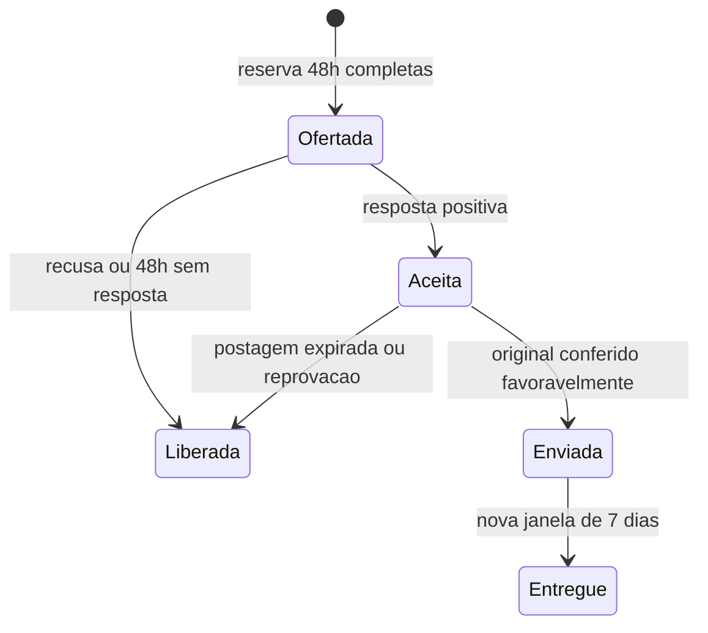
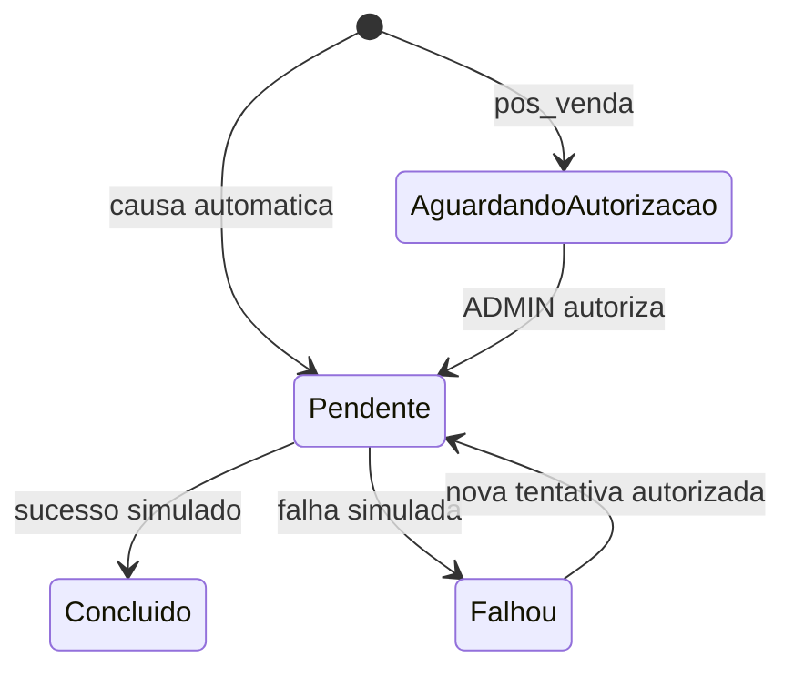

# Estados e limites temporais

Estados técnicos propostos para materializar as regras do PDF. Convenção exata do instante de vencimento será ratificada em TASK-001; testar antes/no limite/depois.

## Checkout — RN-007/008

Converter significa criar pedido Pix/boleto ou criar pedido pago após cartão aprovado dentro do prazo. Recusa de cartão e mudança de endereço não renovam o prazo. Encerrado/Expirado termina aquela finalização; o carrinho continua disponível e nova reserva exige confirmação e validação. Cartão aprovado tarde não passa a Convertido: cria obrigação de estorno.

## Pedido — RN-011/015/019

Devolução tem ciclo independente, inclusive solicitação pré-envio. Cancelamento parcial não torna todo pedido CANCELLED; unidades remanescentes seguem. Cobrança antiga/tardia nunca reativa Cancelado.

## Oferta de substituto — RN-022/023

Espera de 30 dias começa após conferência. Oferta ativa iniciada antes do fim suspende conversão, preservando 48h completas. Sem oferta/aceite após o limite, converter para devolução; não autorizar estorno automaticamente.

## Estorno — RN-041

Falha mantém cancelamento/devolução válidos. Operador não autoriza tentativa de estorno de pós-venda.
